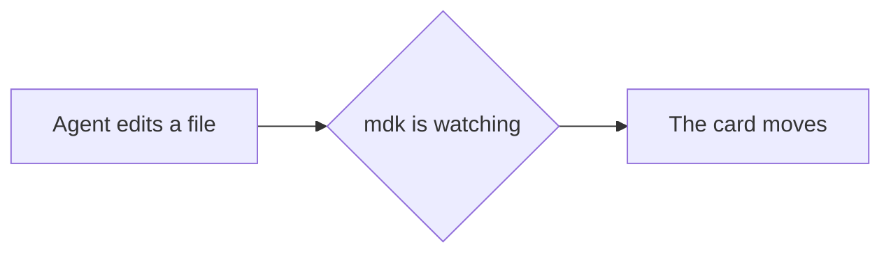

# Preview showcase

Open this card and switch to the Preview tab. Everything below is plain text in the file.

- [x] Read the rendered card
- [ ] Tick this box in the Subtasks box above the preview

## Text

A link to another card: [[Quick-add syntax]]. A link to a card that does not exist: [[not written yet]]. An [external link](https://github.com/Abdulkader-Safi/md-kanban) opens in your browser. Some ==highlighted words==. A price stays a price: $5 a month, or $50 a year.

%% This comment is in the file and nowhere on screen. %%

## Callouts

> [!NOTE]
> A GitHub-style note.

> [!warning] Blocked
> A callout with its own title.

> [!faq]- Why is this folded?
> The `-` after the type folds it. Click the title to open it.

## Code

```rust title="src/main.rs"
fn main() {
    println!("every card is a file");
}
```

## Maths

Inline: $e^{i\pi} + 1 = 0$. On its own lines:

$$
\int_0^\infty e^{-x^2}\,dx = \frac{\sqrt{\pi}}{2}
$$

## Diagram



## Table

| Column | Status in the file |
| ------ | ------------------ |
| To Do | `todo` |
| In Progress | `in-progress` |
| Done | `done` |
