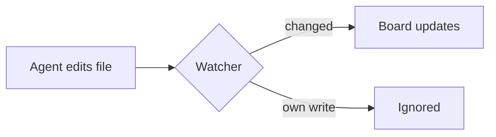

# Preview spike

Plain text with a [[other-card|wikilink]], a missing [[nope]], an [external link](https://example.com) and ==highlighted words==. It costs $5 a month, or $50 a year. Inline maths: $e^{i\pi} + 1 = 0$ sits in the line.

> [!NOTE]
> An open GitHub callout with **bold** text.

> [!faq]- Folded Obsidian callout
> This body is hidden until the header is clicked.

$$
\int_0^\infty e^{-x^2}\,dx = \frac{\sqrt{\pi}}{2}
$$

```rust
// A highlighted code block with a header.
fn main() {
    let cards = vec!["todo", "done"];
    println!("{} cards", cards.len());
}
```



| Column | Colour |
| ------ | ------ |
| To Do  | blue   |
| Done   | green  |

- [x] a ticked task
- [ ] an open task

Local image: ![[pic.png|96]] and a remote one that must not load: 

Bad maths shows its source: $\frac{1}{$ and code keeps `==this==` and `[[this]]`.
